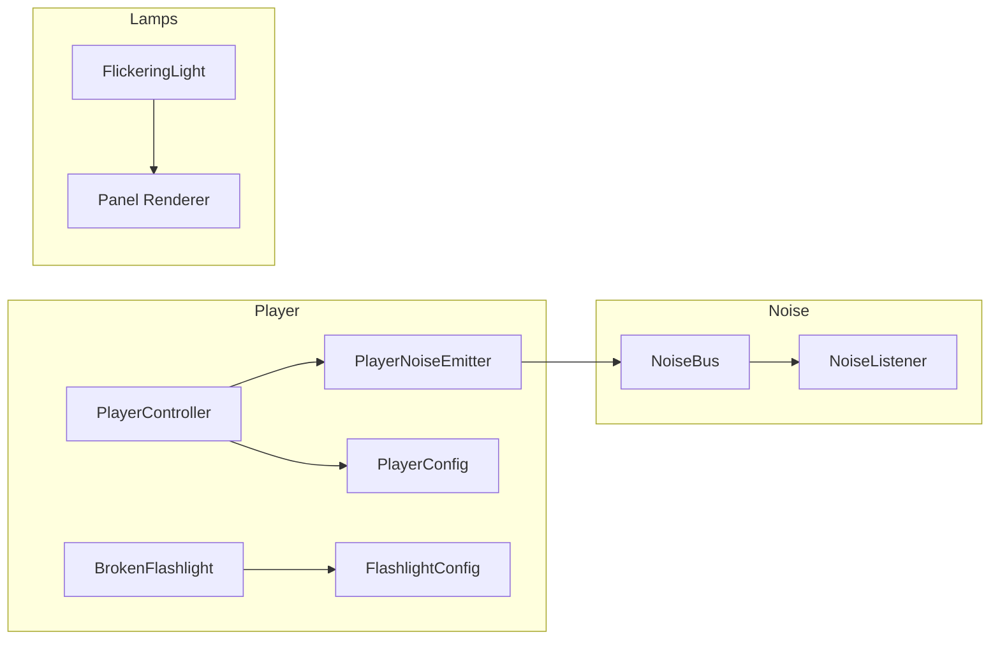

# Backrooms — теория, карта кода и собес

Документ для спокойного разбора проекта. Визуал (туман, тусклые лампы, фонарик) уже настроен — здесь про **как устроен код** и **что говорить на собесесе**.

---

## 1. Карта: что где лежит

| Папка | Роль | Runtime в билде? | Открывать на собесе? |
|-------|------|------------------|----------------------|
| `Scripts/Gameplay/Player/` | Игрок: движение, конфиг, фонарик | Да | **Да — ядро** |
| `Scripts/Gameplay/Noise/` | Шум: шина, emitter, listener | Да | **Да — архитектура** |
| `Scripts/Gameplay/Lighting/` | Мерцание ламп + emission панели | Да | **Да — PropertyBlock** |
| `Scripts/Editor/Builders/` | Сборка коридоров greybox | Нет (только Editor) | Кратко: «тулзы для уровня» |
| `Scripts/Editor/Lighting/` | FIX Lights, Atmosphere, UV/seams | Нет | Не тащить в демо-код |
| `Configs/` | `PlayerConfig`, `FlashlightConfig` (SO) | Да (ассеты) | **Да — SO** |
| `Prefabs/` | `FluorescentPanel`, Hell | Да | Да — Prefab |
| `Art/`, `Level0_Greybox.unity` | Визуал / сцена | Да | Показать Play, не код |

**Правило:** на собесесе показываешь **Player + Noise + FlickeringLight + один Prefab**. Editor-меню — одна фраза: «редакторские скрипты для greybox, в билд не входят».

---

## 2. Схема связей (кто кого вызывает)

### Сценарий A — бег (шум)

1. Игрок зажал Shift → `PlayerController.MoveFixed` видит sprint.
2. Вызов `_noiseEmitter.Notify(moving, sprint, crouch)`.
3. `PlayerNoiseEmitter` шлёт `NoiseBus.Emit(позиция, loudness)`.
4. Все `NoiseListener`, кто подписан в `OnEnable`, получают событие.
5. Если громко и близко → сейчас `Debug.Log` (заготовка под AI).

**Смысл:** игрок **не знает** про слушателей. Слушатель **не ищет** игрока через `Find`. Это слабая связанность.

### Сценарий B — мигание лампы

1. `FlickeringLight.Update` считает intensity (Perlin + редкий dip).
2. Пишет в `Light.intensity` (пятно на стенах/полу).
3. Пишет в emission панели через `MaterialPropertyBlock` (прямоугольник чуть пульсирует).
4. Shared material `Mat_Fluorescent` **не меняется** → соседние лампы не синхронно ломаются.

### Сценарий C — фонарик

1. `F` → `BrokenFlashlight.SetOn`.
2. Вкл/выкл Spot + Point fill на камере.
3. Числа яркости/дальности — из `FlashlightConfig` (SO), не захардкожены в логике toggle.

---

## 3. Теория по блокам + собес

### 3.1 ScriptableObject (конфиг)

**Файлы:** `Player/PlayerConfig.cs`, `Player/FlashlightConfig.cs`, ассеты в `Configs/`.

**Зачем:** данные (скорость, углы, яркость) отдельно от поведения (MonoBehaviour). Крутишь в Inspector / несколько пресетов, код не переписываешь.

**MonoBehaviour vs SO (выучить):**

| | MonoBehaviour | ScriptableObject |
|--|---------------|------------------|
| Живёт | На объекте в сцене/префабе | Как ассет в Project |
| Обычно | Поведение + refs | Данные / баланс / shared settings |
| Инстансов | Много (каждый GO) | Один ассет → много читателей |

**Вопрос:** «Зачем ScriptableObject?»  
**Ответ:** «Баланс и настройки выносим в ассет: один `PlayerConfig` могут читать игрок и тесты; можно сделать Easy/Hard без ветвлений в коде. Поведение остаётся на компоненте.»

---

### 3.2 PlayerController — движение и кадр

**Файл:** `Player/PlayerController.cs`.

**Что делает:** Look (мышь) в `Update`, движение Rigidbody в `FixedUpdate`, присед, вызов NoiseEmitter.

**Почему FixedUpdate для движения:** физика Unity тикает с фиксированным шагом. Если двигать Rigidbody только в `Update`, на разном FPS будет разное ощущение / телепорты. Look оставляем в `Update` — отзывчивее.

**Почему Rigidbody + Capsule, не CharacterController:** у нас нужны нормальные столкновения с тонкими стенами greybox; CC раньше «проскальзывал». На собесе: «выбрала kinematic/динамический Rigidbody + Continuous collision — для FPS с коридорами».

**Вопрос:** «Awake / OnEnable / Start / Update — порядок?»  
**Ответ (коротко):** Awake (инициализация себя) → OnEnable (подписки) → Start (когда все Awake прошли) → Update каждый кадр → FixedUpdate для физики. Подписки на события — в OnEnable, отписка в OnDisable.

---

### 3.3 Noise — event bus (Observer)

**Файлы:** `Noise/NoiseBus.cs`, `PlayerNoiseEmitter.cs`, `NoiseListener.cs`.

**Паттерн:** статическая шина + `event Action<Vector3, float>`. Издатель вызывает `Emit`, подписчики реагируют.

**Почему не `FindObjectOfType` у монстра на игрока:** жёсткая связь, хрупко, плохо масштабируется. Шина = «кто угодно может шуметь / слушать».

**Обязательно:** `OnEnable +=`, `OnDisable -=`. Иначе утечка / вызов на уничтоженном объекте.

**Вопрос:** «Как сделать, чтобы враг слышал игрока без прямой ссылки?»  
**Ответ:** «Event bus / Observer: игрок emit’ит шум с позицией и громкостью, слушатели фильтруют по дистанции и порогу.»

---

### 3.4 FlickeringLight — свет и emission

**Файл:** `Lighting/FlickeringLight.cs`.  
**Prefab:** `Prefabs/FluorescentPanel.prefab` (корень → `Panel` mesh + `Spot Light`).

**Два канала «видимости» лампы:**

1. **Light** — реально освещает мир (URP Additional Light).
2. **Emission** на меше — сам прямоугольник «светится» на экране.

**MaterialPropertyBlock:** пишем `_EmissionColor` на **конкретный Renderer**, не на `sharedMaterial`. Иначе все панели с одним материалом мигали бы одинаково и правка осталась бы в ассете.

**Вопрос:** «Почему нельзя в Update делать `renderer.material.SetColor` на shared?»  
**Ответ:** «`material` создаёт инстанс (лишняя память), `sharedMaterial` меняет ассет для всех. PropertyBlock — правильный путь для per-instance параметров без клонирования материала.»

---

### 3.5 BrokenFlashlight — Spot + fill

**Файлы:** `Player/BrokenFlashlight.cs` + `FlashlightConfig`.

**Зачем два света:** Spot даёт направленный луч; Point fill подсвечивает объём рядом с игроком (коридор читается не только «пятном на стене»). В URP Additional Lights ограничены — на собесе можно сказать: «два local light на игроке, без теней, чтобы дёшево».

**Вопрос:** «Как сделать фонарик?»  
**Ответ:** «Spot на камере, toggle по кнопке, настройки в SO; опционально soft fill Point для near field.»

---

### 3.6 Prefab

**Идея:** ассет-шаблон → instance в сцене. Override на instance (позиция) не ломает префаб. Меняешь префаб лампы → обновляются все instance (если нет override на том поле).

**Вопрос:** «Prefab vs instance vs Apply?»  
**Ответ:** «Prefab — шаблон в Project. Instance — копия в сцене. Override — локальное отличие. Apply — записать отличие обратно в префаб; Revert — сбросить к префабу.»

---

### 3.7 Editor vs Runtime

**Папка:** `Scripts/Editor/...`  
Скрипты с `MenuItem`, `#if UNITY_EDITOR` — **не попадают в player build**. Ими собрали коридор, UV, cookie — это станок, не геймплей.

**Вопрос:** «Что такое Editor-скрипт?»  
**Ответ:** «Код только для редактора: меню, автосборка уровня. В билде игры его нет. Геймплей лежит в Gameplay.»

---

## 4. Какой код учить (порядок)

### Must (перед собесом — разобрать руками)

1. `PlayerConfig.cs` — что такое SO, поля скорости/камеры.  
2. `PlayerController.cs` — Look + MoveFixed + где зовётся noise (не обязательно каждую строку приседа).  
3. `NoiseBus.cs` → `PlayerNoiseEmitter.cs` → `NoiseListener.cs` — одна цепочка, нарисовать на бумаге.  
4. `FlickeringLight.cs` — `ComputeIntensity` / `Apply` / PropertyBlock.  
5. Открыть `FluorescentPanel.prefab` в Hierarchy: где Panel, где Spot Light.

### Should (если останется время)

6. `FlashlightConfig.cs` + `BrokenFlashlight.cs` — toggle + ApplyBeam.  
7. Один раз кликнуть `Backrooms/FIX Lights` в голове понять: Editor меняет префабы, не runtime.

### Later / не для первого собеса

- `Level0CorridorBuilder`, `HellWingBuilder`, все `Fix*` — достаточно фразы про greybox tools.  
- Не учить наизусть числа intensity/fog.

### Пять фраз выучить наизусть

1. **SO** — данные отдельно от поведения, баланс без перекомпиляции.  
2. **Event bus** — издатель не знает подписчиков; подписка OnEnable/OnDisable.  
3. **FixedUpdate** — движение через Rigidbody, чтобы физика была стабильной.  
4. **PropertyBlock** — per-renderer параметры без порчи sharedMaterial.  
5. **Editor-only** — тулзы уровня не в билде; геймплей в Gameplay.

---

## 5. Что честно сказать «ещё нет»

| Тема | Статус у нас |
|------|----------------|
| Input Actions asset | Пока `Keyboard.current` / `Mouse` — работает, позже вынести |
| UI / HUD / пауза | Папка `Scripts/UI` пустая — заложено |
| Save / load | `Infrastructure` пустая |
| AI монстра | `NoiseListener` пишет в Console — точка расширения |
| Addressables / build pipeline | Не трогали |

На собесесе: «Сейчас вертикальный срез: контроллер, SO, шина шума, лампы с PropertyBlock, фонарик. Дальше — AI на NoiseListener и UI.»

---

## 6. Как отвечать, если спросят «покажи код»

1. Открыть сцену → Play 10 секунд (коридор, F, лампы).  
2. `PlayerController` + `PlayerConfig`.  
3. `NoiseBus` цепочка.  
4. `FlickeringLight` + Prefab панели.  
5. Если спросят про уровень: «собирала Editor-меню, в рантайме уровень — сцена/префабы».

Не открывать сразу `SetupFluorescentSpotCookieMenu` — это не история про геймдизайн-код.
