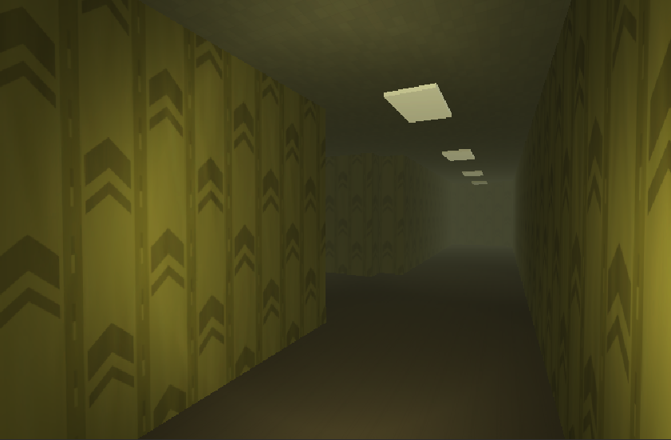

# Backrooms

First-person horror set in **Level 0** of the Backrooms: yellow corridors, buzzing fluorescents, damp carpet — inspired by Kane Pixels.

Goal (full game): find the exit in 10–15 minutes without being caught.

## Status

**Level 0 greybox playable slice** — atmosphere + player loop in place:

- Unity 6 + URP scene [`Assets/_Project/Level0_Greybox.unity`](Assets/_Project/Level0_Greybox.unity)
- FPS on **Rigidbody** + `PlayerConfig` (ScriptableObject)
- **Noise event bus** (walk/sprint/crouch → listeners) for future AI
- Dim fluorescent **prefabs** (Spot + cookie, soft panel flicker via `MaterialPropertyBlock`)
- Player **flashlight** (`F`) — Spot + near fill, settings in `FlashlightConfig`
- Editor tools under **Backrooms/** (corridor/hell builders, FIX Lights, atmosphere)

Next (not done yet): procedural maze, entity AI on `NoiseListener`, Input Actions asset, UI/HUD, WebGL build.

## Tech

- Unity 6 LTS, URP, New Input System (currently Keyboard/Mouse polling; Actions later)
- Runtime code in `Assets/_Project/Scripts/Gameplay/` (`Player`, `Noise`, `Lighting`)
- Editor-only tools in `Assets/_Project/Scripts/Editor/` (not in player build)
- Balance via ScriptableObjects in `Assets/_Project/Configs/`

## Open in Unity

1. Unity Hub → Add → this repo folder
2. Editor **6000.6.x**
3. Open `Assets/_Project/Level0_Greybox.unity`
4. Play — move with WASD, look with mouse, **F** = flashlight
5. Optional menus: **Backrooms → FIX Lights**, **Setup Atmosphere**, corridor/hell builders
